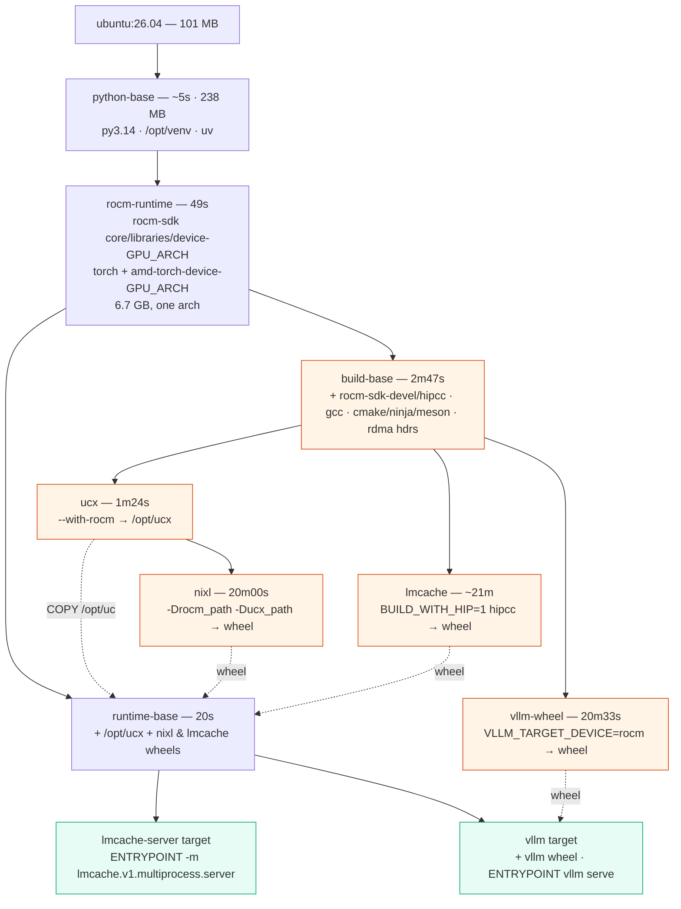

# vllm + lmcache (MP) + nixl on ROCm

Two container images, built with `docker buildx bake`, for KV-cache-offloaded
inference on AMD Instinct GPUs:

| Target | Image | Contains |
| --- | --- | --- |
| `vllm` | `vllm-lmcache-rocm:<tag>-<arch>` | vLLM server + LMCache MP connector + NIXL |
| `lmcache-server` | `lmcache-server-rocm:<tag>-<arch>` | the standalone LMCache MP cache server |

ROCm and PyTorch are consumed as prebuilt wheels; **UCX, NIXL, LMCache and
vLLM are all built from source** against them.

## Build DAG



Timings are from a cold `GPU_ARCH=gfx1201` bake on a 128-core EPYC 7513 with
an empty ccache, so they are an upper bound — the per-stage figures come from
BuildKit's own `DONE` records. `lmcache` is approximate: that run died at
21m33s on an unrelated error, after the hipify and most of the compile.

Three things the numbers show that the shape alone does not:

- **`nixl` is not cheap.** At 20m it rivals `vllm-wheel`, and because it sits
  behind `ucx` the `ucx → nixl` chain is ~21m24s — the real critical path, not
  vLLM as you might assume.
- **The three compile stages are within ~1m of each other**, so they retire at
  roughly the same time and the wall clock is ~25m rather than their 42m sum.
- **`vllm-wheel` is Amdahl-bound on a single file.** Its ninja graph has only
  51 jobs; 48 finish in the first 4 minutes, then nothing completes for 15
  while `csrc/rocm/attention.hip.o` compiles on one core. That one translation
  unit is ~965s, 78% of the stage. `MAX_JOBS=64` does reach ninja (`ninja -j
  64`), so neither raising it nor a bigger machine changes anything.

ccache is wired through every compile stage and is confirmed in the chain
(`sh -c ccache clang++ …`), but **measured no cross-build speedup**: the same
`attention.hip.o` took 1182.7s cold and 1210.7s on a `--no-cache` rebuild that
re-ran every step. Treat the ccache setup as unproven — the stages now end with
`ccache -s`, so the next build's hit rate lands in `buildx history logs`.

Orange stages are build-only: the 7 GB `rocm-sdk-devel` tree, the compilers and
the source checkouts live there and are never copied forward — only wheels and
`/opt/ucx` cross into the green shipping stages. `ucx → nixl`, `lmcache` and
`vllm-wheel` have no edges between them, so BuildKit runs all three
concurrently.

## Build

Needs a `docker-container` builder (the default `docker` driver cannot export
build cache):

```sh
docker buildx create --name builder --driver docker-container --bootstrap --use
docker buildx bake                  # both images, for gfx90a
docker buildx bake vllm             # just the serving image
GPU_ARCH=gfx942 docker buildx bake  # retarget to MI300X / MI325X
```

To target whatever GPU this host actually has, let ROCm name it:

```sh
GPU_ARCH=$(rocm_agent_enumerator | grep -v gfx000 | sort -u | head -1) docker buildx bake
```

`rocm_agent_enumerator` reads KFD topology from sysfs rather than initialising
the runtime, so it works even when ROCr enumeration is broken. It has to run on
the **host**: build stages have no GPU, where it exits 0 printing nothing, so it
cannot drive `GPU_ARCH` from inside the Dockerfile. `gfx000` is the CPU agent.

Known-good targets: `gfx90a` (MI210/MI250), `gfx942` (MI300X/MI325X), `gfx950`
(MI350X), `gfx908` (MI100), `gfx1200`/`gfx1201` (RDNA4). Only `gfx90a` has been
built and run here; the rest are whatever the wheel index offers.

Push to a registry, with registry-backed cache:

```sh
REGISTRY=ghcr.io/sbates130272/ CACHE=registry docker buildx bake --push
```

All knobs are `variable` blocks in [docker-bake.hcl](docker-bake.hcl) and are
settable from the environment: `GPU_ARCH`, `TAG`, `REGISTRY`, `CACHE`
(`local`|`registry`|`none`), `MAX_JOBS`, and the `*_REF` pins for vLLM,
LMCache, NIXL and UCX.

## Run

LMCache MP mode is two processes: a cache server, and vLLM workers that reach
it over ZMQ. The KV buffer itself is never sent over that socket — the worker
exports a GPU IPC handle once at `REGISTER_KV_CACHE`, and later messages carry
only block IDs.

```sh
MODEL=Qwen/Qwen3-8B docker compose -f deploy/compose.yaml up
```

`mp-serve` (the compose entrypoint) starts the cache server, waits for its
port, then `exec`s `vllm serve` with the `LMCacheMPConnector` config wired up.

### Why one container

Both processes run in the **same** container, because that is the arrangement
we could get working on this setup. Splitting them surfaced as `Error handling
request RequestType.REGISTER_KV_CACHE` on the cache server and a dead engine
core on vLLM. Minimal reproducer: export a tensor handle with
`UntypedStorage._share_cuda_()` in one container, import it with
`_new_shared_cuda` in another.

| Arrangement | Result |
| --- | --- |
| two processes, one container | imports fine |
| two containers, `ipc: host` | `hipErrorInvalidDevicePointer` |
| ... plus `pid: host` | `hipErrorInvalidDevicePointer` |
| ... plus `--privileged`, `seccomp=unconfined`, card node | `hipErrorInvalidDevicePointer` |

**This is an observation, not a root cause** — the table is black-box, and
`hipErrorInvalidDevicePointer` is the HIP-level symptom rather than the reason.
Cross-container GPU IPC is expected to work: LMCache's own Kubernetes example
runs the cache server as a DaemonSet and vLLM as a separate Deployment, i.e.
separate pods. Unresolved leads, in rough order of suspicion:

1. **Driver/userspace skew.** This host carries `amdgpu-dkms 6.14.14` from the
   `30.10.1` branch alongside `amdgpu-core 1:7.0.70001`, with ROCm 10.1
   userspace in the container. KFD's `AMDKFD_IOC_{EXPORT,IMPORT}_DMABUF` is
   exactly where that would bite IPC while leaving same-container paths intact.
2. **Namespace sharing vs both-to-host.** The table only ever points both
   containers at the host namespaces; `--ipc container:X --pid container:X`
   (the pod model) is untested.
3. **Get the real error** — `AMD_LOG_LEVEL=4` on the importer plus `dmesg`
   during the failed import will name the failing ioctl.

The `lmcache-server` image is built and useful regardless — for a cache server
on another host, or for non-GPU-IPC transfer modes. If the above is resolved it
also becomes a sidecar, and `deploy/compose.yaml` can go back to two services.

Container settings that *are* required:

| Setting | Why |
| --- | --- |
| `ipc: host` | torch's GPU IPC keeps its handle refcount in `/dev/shm` |
| `/dev/kfd` + one `/dev/dri/renderD*` | the GPU. Only the render node in use, not all of `/dev/dri` |
| `group_add: 44, 109` | host `video` / `render` GIDs owning those nodes |

Deliberately *not* set: `pid: host`, `privileged`, `network: host`.

## How it is kept small

ROCm 10.1 ships as Python wheels (TheRock layout) rather than an apt repo:
`rocm-sdk-core` plus a per-GFX `rocm-sdk-device-<arch>`, with PyTorch split the
same way into `amd-torch-device-<arch>`. Installing only the one arch you are
targeting is the entire slimming story:

| site-packages | |
| --- | --- |
| stock `rocm/pytorch:rocm10.1.0_…` (25 targets) | 24 GB |
| this build, `gfx90a` only | 6.7 GB |

On top of that: the 7 GB `rocm-sdk-devel` tree, the compilers and the source
checkouts live only in build stages and are never copied into the runtime
images; `apt` lists and archives are cache mounts; and the two targets share
one `runtime-base` layer, so the cache server does not carry vLLM.

## Build cache

`ccache`, `uv` and `apt` all use `--mount=type=cache`, so they persist across
builds without entering any layer. Stage-level cache is exported per target
and per GPU arch, to `.cache/buildx/` by default or to
`${REGISTRY}buildcache:<target>-<arch>` with `CACHE=registry`.

The source-built components (UCX → NIXL, LMCache, vLLM) are independent
stages, so BuildKit compiles them in parallel.

## Versions

Pinned in [docker-bake.hcl](docker-bake.hcl): ROCm 10.1.0, PyTorch
2.13.0+rocm10.1.0, vLLM v0.31.0, LMCache v0.5.5, NIXL v1.5.0, UCX v1.22.0.

## Verified on

One MI210 (gfx90a), ROCm 10.1 + amdgpu DKMS 6.14.14, Ubuntu 24.04 host:
`vllm serve Qwen/Qwen2.5-0.5B-Instruct` with the MP connector reaches
`health: 200`, and a repeated 1.5k-token prompt gives

```text
LMCache INFO: Stored 1280 tokens in 0.038 seconds   (lmcache_driven_transfer)
LMCache INFO: Retrieved 1280 tokens in 0.001 seconds
vllm:external_prefix_cache_hits_total  1280
```

`lmcache_driven_transfer` is the GPU IPC path, so this exercises the real
MP handoff rather than a CPU fallback.

## Upstream patches

Seven one-line `sed`s in the Dockerfile, each commented where it is applied:

| Patch | Why |
| --- | --- |
| LMCache `-std=c++17` → `c++20` | torch 2.13 headers require C++20 |
| LMCache `numpy<=2.2.6` → `numpy` | pinned for PyPI nixl's numba; we build NIXL from source without it, and 2.2.6 has no cp314 wheel |
| LMCache: drop `cupy-rocm-7-0` | 381 MB built against ROCm 7.0, cannot import on 10.1 (`librocfft.so.0`); only reached by lazy imports in CUDA-only GDS / `RawCudaIPCWrapper` paths |
| LMCache built via `setup.py` not `uv build` | `uv build --no-build-isolation` loses setuptools on 3.14 |
| vLLM: drop `mooncake-transfer-engine-rocm` | unused here, and its wheels stop at cp313 |
| vLLM: skip `requirements/build/rocm.txt` | its `--extra-index-url` 403s and then shadows PyPI |
| NIXL meta package built separately | the backend wheel only exposes `nixl_rocm`; LMCache imports `nixl` |

Plus one `.pth` pointing `amdsmi` at the SDK's own bindings — without it vLLM
cannot infer the device type and falls back to `UnspecifiedPlatform`.

## Notes

- `gfx90a` (MI210/MI250) has no AITER or CK FlashAttention support — those are
  gfx942+. vLLM falls back to its Triton attention backend.
- LMCache's own ROCm Dockerfile skips NIXL and targets ROCm 7.x. Here NIXL is
  built with `-Drocm_path`, against a UCX configured `--with-rocm`.
